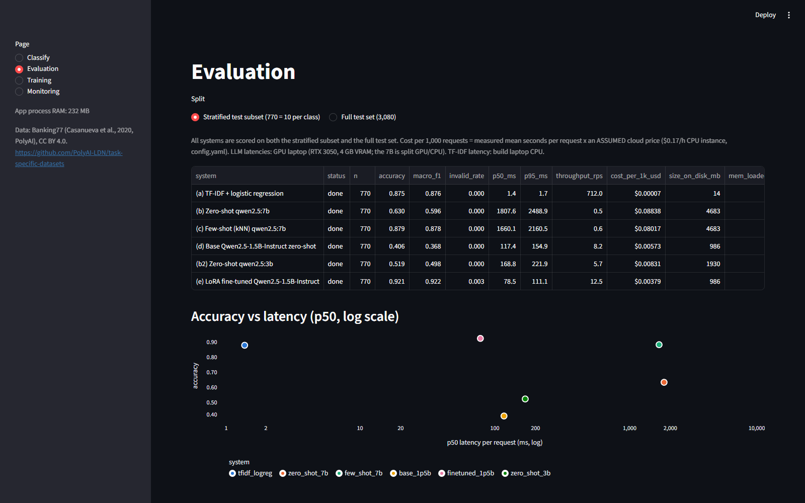

# Fine-tuning vs prompting: Banking77 intent classification (LoRA)

> **Status: finished (2026-10-02).** All six systems evaluated on the full test set (3,080) and the subset (770).
> LLM inference on the GPU laptop (RTX 3050 Laptop, 4 GB VRAM, 8 GB RAM); LoRA training on a free Colab T4.
> Every number below comes from a real run.
>
> **Headline:** the LoRA fine-tuned Qwen2.5-1.5B reaches **0.927 accuracy / 0.929 macro-F1** on the full test,
> beating the TF-IDF baseline (0.890) and kNN few-shot qwen2.5:7b (0.888), both with exact McNemar p < 1e-10,
> while being 21x faster than the 7B (79 ms vs 1.66 s p50) and a fifth of its size (1.0 GB vs 4.7 GB).
> Untuned, the same 1.5B model scores 0.412. Training took 34 minutes on a T4 (0.56 GPU-hours).




App pages: [Classify](results/screenshots/ft_Classify.png) | [Evaluation](results/screenshots/ft_Evaluation.png) | [Training](results/screenshots/ft_Training.png) | [Monitoring](results/screenshots/ft_Monitoring.png). Runs fully locally with Ollama; no paid APIs.

## Problem
When does fine-tuning a small open LLM beat prompting a bigger one? This project compares five ways of routing
a bank's customer-support messages to one of 77 intents: accuracy, macro-F1, latency, memory, and cost.

## Architecture
```
 data/raw (PolyAI CSVs) --prepare_data.py--> data/splits (train 9,000 | val 1,003 | test 3,080 | test_subset 770)
        |
        +--> (a) TF-IDF + LogReg          run_baseline.py       (sklearn, CPU, C tuned on val)
        +--> (b) zero-shot qwen2.5:7b     eval_llm.py           \
        +--> (c) kNN few-shot qwen2.5:7b  eval_llm.py            |  Ollama (localhost:11434), structured output
        +--> (d) base qwen2.5:1.5b        eval_llm.py           /   = JSON enum of the 77 labels
        +--> (e) LoRA Qwen2.5-1.5B        notebooks/finetune_lora_colab.ipynb (Colab T4)
                                            -> GGUF Q4_K_M -> import_finetuned.ps1 (ollama create) -> eval_finetuned.py
                    |
        per-item JSONL caches (data/cache/) --summarize_results.py--> results/comparison.csv, per_class_f1.csv, confusions.json
                    |
        streamlit_app.py: Classify | Evaluation | Training | Monitoring (SQLite traces, data/traces.db)
```

## Dataset and licence
**Banking77** (Casanueva et al., 2020, "Efficient Intent Detection with Dual Sentence Encoders", PolyAI):
13,083 single-turn banking customer-support messages, 77 intents (train 10,003 / test 3,080).
Licence: **Creative Commons Attribution 4.0 (CC BY 4.0)**, confirmed from the Hugging Face dataset card
(`PolyAI/banking77`, saved to `data/raw/hf_dataset_card.md`). Source files: the original CSVs from
https://github.com/PolyAI-LDN/task-specific-datasets (same data as the HF version).

**Splits (seed 42, `data/splits/`):**
- validation = a stratified 10% of the original train (1,003 rows; 4-19 per class), used for tuning and early stopping only;
- train = the other 9,000;
- test = the full original test set (3,080; 40 per class), scored once for the reported numbers;
- test_subset = a stratified 770 (10 per class) for the slow LLM systems;
- val_subset = 154 (2 per class) for prompt tuning.

Six test messages also appear verbatim in train (a property of the original dataset; kept as is).

## Setup and run (Windows)
```powershell
cd AI_Engineer_Portfolio\finetune_vs_prompting
python -m venv .venv
.venv\Scripts\pip install -r requirements.txt
.venv\Scripts\python scripts\prepare_data.py        # download + splits (seconds)
.venv\Scripts\python scripts\run_baseline.py        # (a) TF-IDF baseline (a few minutes incl. the C grid)
ollama pull qwen2.5:7b; ollama pull qwen2.5:1.5b
.venv\Scripts\python scripts\eval_llm.py --system zero_shot_7b --split test_subset
.venv\Scripts\python scripts\eval_llm.py --system few_shot_7b  --split test_subset
.venv\Scripts\python scripts\eval_llm.py --system base_1p5b    --split test_subset
# (e): run notebooks\finetune_lora_colab.ipynb on Colab and unzip its outputs into models\,
#      or download the trained files from this repo's Releases page (GGUF + LoRA adapter), then
powershell -ExecutionPolicy Bypass -File scripts\import_finetuned.ps1
.venv\Scripts\python scripts\eval_finetuned.py
.venv\Scripts\python scripts\summarize_results.py
.venv\Scripts\streamlit run streamlit_app.py
.venv\Scripts\python -m pytest -q
```
The LLM evaluations cache every item and resume after an interruption. They hold `AI_Engineer_Portfolio\.llm_lock`
while running, and wait if another project holds it.

## Results (test set)

### Comparison
Full test set (3,080), the headline comparison (`results/comparison.csv`):

| System | Accuracy | Macro-F1 | Invalid-label rate | p50 / p95 latency | Loaded memory (VRAM) | Size on disk | Cost / 1,000 requests* |
|---|---|---|---|---|---|---|---|
| (a) TF-IDF + LogReg | **0.890** | **0.890** | 0 | 1.3 / 1.7 ms | - | 14 MB | $0.00007 |
| (b) Zero-shot qwen2.5:7b | 0.626 | 0.597 | 0 | 1,771 / 2,421 ms | 5.1 GB (2.3 GB) | 4.7 GB | $0.086 |
| (c) **Few-shot (kNN, k=10) qwen2.5:7b** | **0.888** | **0.888** | 0 | 1,657 / 2,160 ms | 5.1 GB (2.3 GB) | 4.7 GB | $0.080 |
| (b2) Zero-shot qwen2.5:3b | 0.531 | 0.511 | 0 | 172 / 225 ms | 2.2 GB (all) | 1.9 GB | $0.008 |
| (d) Base Qwen2.5-1.5B zero-shot | 0.412 | 0.380 | 0 | 119 / 159 ms | 1.2 GB (all) | 1.0 GB | $0.006 |
| (e) **LoRA fine-tuned Qwen2.5-1.5B** | **0.927** | **0.929** | 0.004 (13 of 3,080) | 79 / 113 ms | 1.2 GB (all) | 1.0 GB | $0.004 |

Subset (770, 10 per class), same systems: (a) 0.875 / 0.876, (b) 0.630 / 0.596, (c) 0.879 / 0.878,
(b2) 0.519 / 0.498, (d) 0.406 / 0.368, (e) 0.921 / 0.922 (accuracy / macro-F1). The subset and full-test
rankings agree.

**Significance (paired, full test, exact McNemar):**

| Pair | Only the first right | Only the second right | p |
|---|---|---|---|
| (e) LoRA vs (a) TF-IDF | 205 | 93 | 7.7e-11 |
| (e) LoRA vs (c) few-shot 7B | 210 | 91 | 5.5e-12 |
| (c) few-shot 7B vs (a) TF-IDF | 152 | 159 | 0.73 (no difference) |

**Training (e)** (`models/training_log.json`): QLoRA on a free Colab Tesla T4. 9,000 training messages; early
stopping on validation loss stopped the run at epoch 2.5 (1,405 steps) and kept the best checkpoint from epoch
2.0 (val loss 0.0467; the next evaluation rose to 0.0488). Training time 33.6 min (0.56 GPU-hours, peak GPU
memory 8.6 GB, which is why it could not train on the 4 GB laptop GPU). Validation accuracy 0.925, which
matches the test result (0.927). At the config's **assumed** T4 price of $0.53/h, training would cost
about $0.30. Exported as GGUF Q4_K_M (986 MB) and served by Ollama like the other models.

\*Cost = measured mean seconds per request x an **assumed** $0.17/h instance price (`config.yaml`), as
computed by `scripts/summarize_results.py`. It is a price assumption, not a measurement; at the config's
assumed T4 price ($0.53/h) the 7B rows would be about $0.26.

**Hardware and latency:** measured on the GPU laptop, one request at a time, model warm (warm-up excluded).
On the 4 GB GPU the 7B model (5.1 GB loaded) is split between GPU (2.3 GB) and CPU; the 3B and 1.5B fit fully
in VRAM. Speed check with Ollama's own timings: qwen2.5:7b about 550 tokens/s prompt processing and
5.5-7 tokens/s generation. The fixed 77-label system prompt is cached by Ollama, so most of the 7B latency is
the per-message tokens and the short JSON answer.

**Reading the results:**
- **Few-shot retrieval is what makes the LLM competitive:** the same 7B goes from 0.626 to 0.888 when the
  10 nearest training messages are in the prompt. Without examples it confuses near-identical label names it
  has never seen used (e.g. `why_verify_identity` vs `verify_my_identity`).
- **Prompting does not beat the baseline.** (c) and (a) are statistically tied (0.888 vs 0.890, p = 0.73),
  while (a) is about 1,200x faster and needs no GPU.
- **Fine-tuning does.** With the same 9,000 labelled messages, LoRA turns the weakest model (1.5B, 0.412
  untuned) into the best one (0.927): +3.6 points over TF-IDF and +3.9 over few-shot 7B, both clearly
  significant. It is also the fastest LLM here (79 ms p50, fully on the GPU, about 43 prompt tokens because
  the label list is learned rather than sent with every request).
- **Which to deploy:** with plenty of labelled data and a fixed label set, fine-tune a small model (best
  accuracy, low latency, about $0.30 of training). TF-IDF stays a strong, free CPU fallback at 0.890.
  Few-shot prompting is the option when labels are few or change often, since it needs no training.
- **Model size matters a lot zero-shot:** 1.5B 0.412 → 3B 0.531 → 7B 0.626.
- Structured output (a JSON enum of the 77 labels) gave a 0% invalid-label rate for (b)-(d). (e) generates
  free text and produced 13 invalid labels (0.4%), counted as errors.

(a) details (`results/baseline_tfidf.json`): word 1-2-gram TF-IDF (sublinear tf) + logistic regression.
C was chosen on validation from {1, 3, 10, 30, 100, 300, 1000}. C=100 was best (val acc 0.888, macro-F1 0.886);
the grid was widened after 100 first came out at its edge. Fit time is about 24 s on the build laptop's i5-1235U.
Per-request latency was measured one message at a time on 500 test messages (single process). Batch throughput
was about 27,000 messages/s. Cost per 1,000 requests is about $0.00007, at an **assumed** $0.17/h CPU instance.
That is a price assumption, not a measurement.

The 770 subset is slightly harder for (a) than the full test set (0.875 vs 0.890). Compare the LLM systems with (a)'s **subset** row.

## Error analysis
**(a) TF-IDF baseline, full test:** 338 errors out of 3,080. The errors cluster in near-duplicate intents that
differ by state or direction, not by topic:

| True -> predicted | Count | Real example |
|---|---|---|
| pending_top_up -> top_up_failed | 5 | "My card was topped this morning but I can't see the funds. Why didn't it complete?" |
| card_acceptance -> card_not_working | 4 | "I am traveling to Germany, Will I be able to use my card there?" |
| balance_not_updated_after_bank_transfer -> transfer_not_received_by_recipient | 4 | "How long will it take for my transferred money to show up?" |
| unable_to_verify_identity -> verify_my_identity | 4 | "I can't verify my identity." |
| verify_my_identity -> why_verify_identity | 4 | "What do you need to verify my identity?" |

The lowest per-class F1 scores are balance_not_updated_after_bank_transfer (0.72), topping_up_by_card (0.76),
transfer_not_received_by_recipient (0.76), wrong_exchange_rate_for_cash_withdrawal (0.77) and pending_transfer (0.78).
Some of these are arguably ambiguous even for a human (e.g. "How long will it take for my transferred money to show up?").
**Buckets** (`scripts/error_analysis.py` -> `results/error_buckets.json`):
- **same_topic** means the true and predicted intents share a topic, e.g. both about top-ups or identity.
- For (a) on the full test: 182 of 338 errors (54%) are same_topic and 156 are different_topic; there are no invalid labels by construction.
- On the subset: 51 same_topic and 45 different_topic.

**LLM systems, full test** (same buckets; `invalid_label` is 0 for all of them):

| System | Errors (of 3,080) | same_topic | different_topic |
|---|---|---|---|
| (e) LoRA 1.5B | 226 | 123 | 90 (+13 invalid labels) |
| (a) TF-IDF | 338 | 182 | 156 |
| (c) few-shot 7B | 345 | 172 | 173 |
| (b) zero-shot 7B | 1,152 | 585 | 567 |
| (b2) zero-shot 3B | 1,445 | 803 | 642 |
| (d) base 1.5B | 1,810 | 942 | 868 |

Top confusions (true -> predicted, `results/confusions.json`):
- **(b) zero-shot 7B:** why_verify_identity -> verify_my_identity (38), card_payment_wrong_exchange_rate ->
  wrong_exchange_rate_for_cash_withdrawal (34), getting_virtual_card -> get_disposable_virtual_card (34),
  unable_to_verify_identity -> verify_my_identity (33), get_physical_card -> change_pin (31). Without examples
  the model falls back on the most generic-sounding label of a family.
- **(c) few-shot 7B:** card_arrival -> card_delivery_estimate (9), unable_to_verify_identity ->
  verify_my_identity (7), get_physical_card -> change_pin (7), transfer_timing -> pending_transfer (7),
  exchange_via_app -> fiat_currency_support (6). The counts are small and spread out, like (a)'s.
- **(e) LoRA 1.5B:** card_arrival <-> card_delivery_estimate (5 and 4), verify_my_identity ->
  unable_to_verify_identity (5), card_payment_fee_charged -> transfer_fee_charged (4), topping_up_by_card ->
  pending_top_up (4). These are the same near-duplicate pairs the other systems confuse, at lower counts.
  Its 13 invalid labels are plausible-sounding intents that don't exist, e.g. "I made a deposit this morning
  but it is still pending?" -> `pending_deposit` (true: balance_not_updated_after_cheque_or_cash_deposit).
  Constrained decoding to the 77 labels would remove this error type.
- (c) and (a) make almost the same number of errors, but (c) has fewer same_topic errors (172 vs 182) and more
  different_topic ones (173 vs 156): the LLM handles fine distinctions inside a family slightly better and
  is pulled off-topic more often by its retrieved examples.

## Design decisions
- **Original CSVs, not the HF loader.** They are the same data, and plain CSV downloads avoid the `datasets` dependency. The licence was checked on the HF card.
- **Stratified test subset (770) for the slow LLMs.** A 7B model on this CPU takes seconds per request, so 3,080 x 3 systems is too slow on the build laptop.
  - The fast systems ((a), and (e) if affordable) run on both the subset and the full test set.
  - On the GPU laptop, the full test can also be run by passing `--split test`.
- **Few-shot = kNN.** The 10 nearest *train* messages (TF-IDF cosine) go in the prompt, the most similar last. Val and test never leak into prompts.
- **Fixed system prompt** holding the 77 labels for (b)-(d), so Ollama's prompt-prefix cache is reused. Few-shot examples go in the user turn, keeping the prefix fixed.
- **Structured output** (JSON schema with an enum of the labels) for (b)-(d). The invalid-label rate is still measured: parse failures, or labels outside the list.
- **The fine-tuned model uses a short system prompt without the label list.** The labels are learned, so a training sequence is at most 114 tokens (mean 57).
  - Its output is unconstrained plain text, so invalid labels are measured honestly.
  - The training and inference template is Qwen2.5 ChatML. `import_finetuned.ps1` writes the Modelfile from the same `src/prompts.py` constants.
  - The CPU dry run confirmed the notebook's tokenizer produces exactly the string `render_chatml()` builds.
- **LoRA settings:** QLoRA 4-bit NF4, r=16, alpha=16, dropout 0, all attention and MLP projections, lr 2e-4 cosine, batch 16.
  - Training runs at most 3 epochs, with an evaluation every half epoch and early stopping (patience 1) on validation loss. The best checkpoint is kept.
  - The loss covers the answer tokens only.
- **Ollama URL `127.0.0.1` instead of `localhost`.** On Windows, Python's `localhost` lookup tries IPv6 first and cost about 2 s per request (measured: a model-list call took 2.4 s vs 0.6 s). That would have distorted every latency number.
- **Cost** = measured mean seconds per request x an hourly price stated in `config.yaml` as an assumption.

## Limitations
- One training run (seed 42); no LoRA hyperparameter search, so (e) could likely go a little higher.
- LLM latencies are from a 4 GB laptop GPU with the 7B partly on the CPU; a GPU that fits the whole 7B would be
  several times faster. (a)'s latency is from the build laptop's i5-1235U CPU.
- No prompt tuning was done on val_subset (the step was optional); the prompts are the ones written before
  the test runs, so test was never used for tuning.
- Cost uses an assumed hourly price; it ignores batching, which would favour all systems.
- The subset has 10 per class, so per-class F1 on it is noisy. Use the full test for per-class conclusions.

## Next steps
See `PROGRESS.md`.

## Runs on an 8 GB laptop
- The app itself uses about 215 MB RAM (measured in the sidebar: 214-220 MB).
- The TF-IDF model is 14 MB.
- LLM footprints (Ollama `/api/ps`, `results/footprint_<system>.json`): qwen2.5:7b 5.1 GB loaded (2.3 GB in VRAM on
  the 4 GB GPU, the rest in system RAM), qwen2.5:3b 2.2 GB, qwen2.5:1.5b 1.2 GB.
- With the 7B loaded, free system RAM dropped to about 0.5 GB on the 8 GB laptop, so run one model at a time and
  close other apps. The fine-tuned (e) GGUF is 986 MB on disk and 1.2 GB loaded, fully in VRAM on a 4 GB GPU,
  so it is the most practical LLM option on this laptop.
